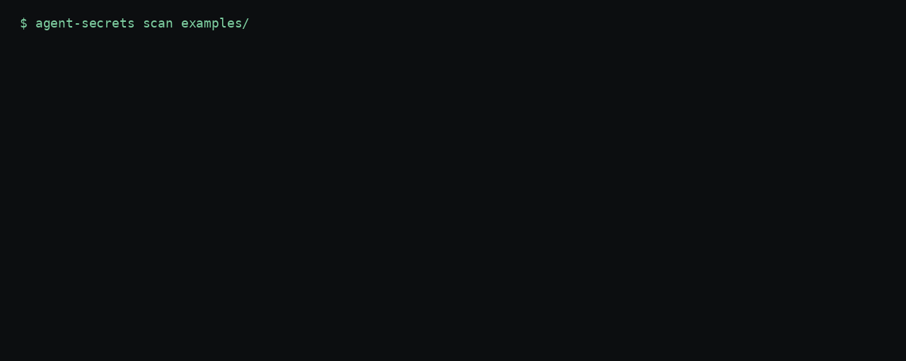

# agent-transcript-secrets

`agent-secrets` finds API keys, tokens, and passwords in AI agent transcripts and settings on your machine, prints a masked report, and can redact the files before you commit.

## The problem

On 9 November 2026, iTnews reported that Apiiro found secrets in public GitHub copies of Claude Code settings and in saved agent transcripts. The article is [Don't ask again in Anthropic's Claude Code leaks developer secrets](https://www.itnews.com.au/news/dont-ask-again-in-anthropics-claude-code-leaks-developer-secrets-630203).

Claude Code asks before it runs most shell commands. The choice "Yes, and don't ask again" stores that command in `.claude/settings.local.json`. When the command contains a key, the key is stored with it. People also commit transcript logs next to the code.

## Privacy

The tool reads paths you pass, or the default directories on your computer. It writes the report to stdout. It does not open a network connection, upload a transcript, or sign in to an account.

## Install

From PyPI, once the first release is published:

```bash
pipx install agent-transcript-secrets
```

The PyPI distribution is `agent-transcript-secrets` and the command it installs is `agent-secrets`. It is unrelated to [`agentsecrets`](https://pypi.org/project/agentsecrets/) on PyPI, which is an SDK for a hosted secrets proxy.

Until that release exists, install from GitHub:

```bash
pipx install "git+https://github.com/kamilkaczmareksolutions/agent-transcript-secrets.git"
```

From a clone:

```bash
pipx install .
```

## Usage

Scan the synthetic fixtures.

```bash
agent-secrets scan examples/
```



The gif is a replay of that command on the fixtures in `examples/`. It is not a recording of a live profile.

With no path, the command scans the default locations that exist on the machine.

```bash
agent-secrets scan
agent-secrets scan --json examples/
agent-secrets redact --dry-run examples/
agent-secrets redact path/to/file.jsonl
agent-secrets install-hook
```

`scan` prints a table with the file, the line, the type, and a masked preview. `--json` prints the same findings as JSON. The tool never prints the full secret.

`redact` replaces each finding with a `[REDACTED:<kind>]` token. It copies the original to a `.bak` file beside it first. `--dry-run` prints the changes and writes nothing. The `.bak` file still holds the secret. Delete that copy after you check the redacted file, and do not commit it.

Exit status is 1 when findings exist, 0 when the tree is clean, and 2 for a missing path, a bad flag, or a hook installed outside a git repository.

### Pre-commit

`.pre-commit-hooks.yaml` is a hook for the pre-commit framework. Pin `rev` to the commit you want to run.

```yaml
repos:
  - repo: https://github.com/kamilkaczmareksolutions/agent-transcript-secrets
    rev: v0.1.0  # pin a tag; until the first tag exists, pin a commit SHA
    hooks:
      - id: agent-secrets
```

`agent-secrets install-hook` writes a git `pre-commit` hook that runs `agent-secrets scan --staged`. The hook looks at staged transcript and settings files. A secret in one of those files blocks the commit. Running `install-hook` again replaces that block and leaves the rest of an existing hook in place.

## Supported formats

Claude Code transcripts are JSONL files under `$CLAUDE_CONFIG_DIR/projects/`, including `subagents` directories. `$CLAUDE_CONFIG_DIR` defaults to `~/.claude`. The tool also reads `settings*.json` in that directory and `./.claude/settings*.json`. The documented project file is `.claude/settings.local.json`. `~/.claude.json` is not read.

Codex CLI transcripts are `rollout-*.jsonl` files under `$CODEX_HOME/sessions/YYYY/MM/DD/`, directly under `$CODEX_HOME/sessions/`, and under `$CODEX_HOME/archived_sessions/`. `$CODEX_HOME` defaults to `~/.codex`.

Cursor agent transcripts are experimental. The tool reads JSONL files under `$CURSOR_CONFIG_DIR/projects/` when the path contains `agent-transcripts`, including a session folder and `subagents`. `$CURSOR_CONFIG_DIR` defaults to `~/.cursor`. Cursor changes this layout. `state.vscdb` and `~/.cursor/chats` are not read.

A path you pass is scanned for `.jsonl`, `.json`, `.txt`, `.log`, `.md`, `.yaml`, and `.yml` files. `.bak` files are skipped unless you name the backup itself.

## Limitations

Detectors are regular expressions for common key shapes, plus an entropy check on assignments whose names end in `key`, `token`, `password`, or `secret`. A vendor format the patterns do not name can pass unseen. A long random-looking placeholder can be flagged.

These shapes are included. OpenAI keys that start with `sk-`, Anthropic keys that start with `sk-ant-`, GitHub `ghp_`, `gho_`, and `github_pat_` tokens, AWS keys that start with `AKIA`, Slack tokens that start with `xox`, Stripe `sk_live_` keys, Google keys that start with `AIza`, PEM private-key banners, `Bearer` tokens, and URLs that embed a password.

The xAI rule matches a token that starts with `xai-`. Treat that rule as experimental.

`sk-xxx`, `your-api-key`, and `<TOKEN>` are ignored, along with a short list of other placeholders.

The tool does not rewrite git history, scan other people's repositories, or rotate a key at the vendor.

Files larger than 32 MiB are skipped.

## Disclaimer

A clean scan does not prove a secret never left the machine. If a key reached a remote repository, rotate it. This tool is not a warranty.

## Related

- [agent-transcript-stats](https://github.com/kamilkaczmareksolutions/agent-transcript-stats) counts sessions in the same local transcript trees.
- [cursor-transcript-cleaner](https://github.com/kamilkaczmareksolutions/cursor-transcript-cleaner) reports Cursor transcript disk use and archives old logs.

## License

MIT. See [LICENSE](LICENSE). Copyright Kamil Kaczmarek.
